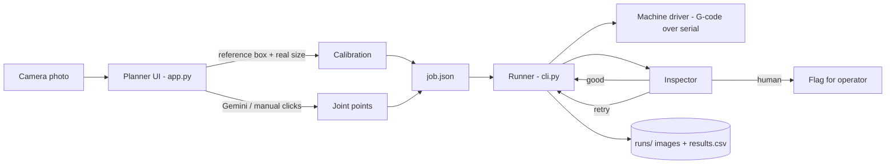

# Architecture



## Why two programs

| | Planner (`app.py`) | Runner (`cli.py`) |
|---|---|---|
| Job | Look at a photo, decide where the joints are | Execute the plan on hardware |
| Runs in | Browser (Streamlit) | Terminal, close to the machine |
| Risk | None, only produces a file | Real motion and heat |
| Contract | writes `job.json` | reads `job.json` |

A browser tab should never be the thing that controls a hot tip. The `job.json` file is the only
contract between them, so either side can be replaced (for example a different detector, or a
touchscreen operator panel) without touching the other.

## Modules

| Module | Responsibility |
|---|---|
| `geometry.py` | pixel <-> mm maths, crop windows, point ordering. Pure functions, fully tested |
| `detection.py` | Joint detection backends (Gemini today; add YOLO / Molmo here) |
| `job.py` | The `job.json` format and validation |
| `config.py` | YAML machine config, strict (typos are errors) |
| `machine.py` | G-code driver: soft limits, `ok` handshake, `DryRunTransport` |
| `camera.py` | Live camera and a static-image stand-in |
| `inspection.py` | `Inspector` interface, `Outcome` (good / retry / human), baseline heuristic |
| `runner.py` | The per-joint state machine and safety `finally` block |

## Per-joint cycle

```
look(before) -> Z safe -> XY above joint -> Z solder -> pulse -> Z safe -> look(after) -> inspect
   inspect = GOOD  -> next joint
   inspect = HUMAN -> flag, next joint (never re-solder excess or bridges)
   inspect = RETRY -> repeat, up to max_retries, then HUMAN
```

Efficiency: points are ordered nearest-neighbour from the origin, the tip only travels at `z_safe`,
and moving to a `park` position before photos is optional (skip it if the camera can see the joint
with the tip raised).

## Calibration chain

1. Planner: the reference box (pixels) + its real width/height -> joint positions in mm from the
   box's bottom-left corner.
2. Config: `box_origin_x/y` = where that bottom-left corner sits in **machine** coordinates.
   Measure it once (jog the tip over the corner and read the position).
3. Inspection: the same `box_px` in `job.json` maps mm back to pixels so the runner can crop each
   joint. This **assumes the camera has not moved** since the planning photo. If it can move,
   re-plan, or add fiducial marks to re-detect the box.

## Safety design

- Dry run is the default. `--live` needs a typed `START`.
- Hard software limits on every move; out-of-range moves raise before anything is sent.
- Travel only at `z_safe`.
- `finally` always sends solder-off and raises Z, including on Ctrl+C and errors.
- `HUMAN` outcomes are never retried automatically.
- Hardware safety (e-stop, limit switches, thermal cutoff on the iron) must not depend on this software.

## Growing the quality inspector

`HeuristicInspector` is a placeholder. Every run saves before/after crops named with the outcome
(`runs/<time>/joint003_try1_after_good.png`). Review them, correct wrong labels, and you have a
training set. Then implement `Inspector.inspect(before, after)` with a small CNN or YOLO classifier
and pass it to `JobRunner`. Nothing else changes.
